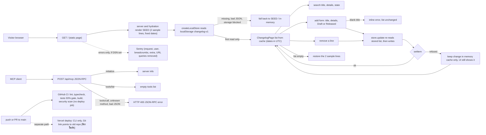
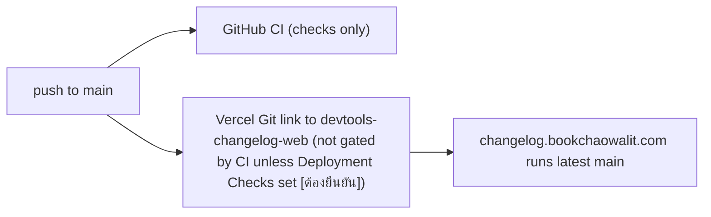

# 01 — Business process (As-Is / To-Be)

devtools-changelog-web คือรายการ release notes ที่เก็บในเบราว์เซอร์ของผู้เยี่ยมชม (localStorage) เริ่มด้วยข้อมูลตัวอย่าง 2 บรรทัด ผู้ใช้เพิ่ม ค้นหา และลบบรรทัดได้ ไม่มี backend, ไม่ดึงข้อมูลจาก repo อื่น และ `/api/mcp` ไม่มี tool ให้เรียก

Last reviewed: 2026-11-28 · commit `06526b0`

## As-Is (จากโค้ดวันนี้)

Sources: `lib/changelog.ts`, `lib/local-store.ts`, `components/changelog-page.tsx`, `app/api/mcp/route.ts`, `next.config.ts` (`/more-projects` 308 to bookchaowalit.com), `lib/sentry.ts`, `.github/workflows/ci.yml`, `README.md`, `PRODUCT.md`

ข้อเท็จจริงสำคัญจากโค้ด:

- ข้อมูลอยู่ใน `localStorage` ของเบราว์เซอร์เดียว (`changelog-v1`) ล้างข้อมูลเว็บแล้วหาย ไม่มี export/sync
- ปุ่ม "Restore the sample lines" ใช้ได้เมื่อรายการว่าง; ถ้ามีคำค้นอยู่ตอนลบบรรทัดสุดท้าย ปุ่มนี้ซ่อนจนกว่าจะล้างคำค้น
- สอง tab เขียนพร้อมกันอาจทับกัน (ไม่มี lock) ตาม PRODUCT.md §Known limits
- ไม่มี workflow deploy ใน repo; ตาม PRODUCT.md (2026-10-23) deploy ด้วย Vercel CLI เท่านั้นและ Git link ชี้ repo เก่า [ต้องยืนยัน] สถานะวันนี้
- `NEXT_PUBLIC_SENTRY_DSN` บน production: [ต้องยืนยัน]; เมื่อเปิด Sentry เป็นข้อยกเว้นของ "ข้อมูลอยู่ในเบราว์เซอร์": error report ถูกส่งออก โดย `beforeSend` ลบ request, user, breadcrumbs, extra, contexts นอก platform, ตัด query/hash และลบ frame vars แต่ไม่ได้กรองข้อมูลอื่นในข้อความ error
- ถ้า `setItem` ถูกปฏิเสธ UI ยังแสดงรายการจาก cache ในหน่วยความจำ (ไม่ถูกบันทึก) และการอัปเดตถัดไปใช้ cache ที่ค้างอยู่แทนการอ่าน storage ใหม่ จนกว่าจะเขียนสำเร็จ

## To-Be (จาก PRODUCT.md §Live URL and deploy state)

Sources: `PRODUCT.md` (owner action D9)

## Gap

| ID | As-Is → To-Be | Status | Owner | Evidence |
|---|---|---|---|---|
| G1 | deploy ด้วย CLI และ Git link ชี้ repo เก่า (push ไม่ deploy) → เชื่อม Vercel Git กับ `devtools-changelog-web` | decide | owner | `PRODUCT.md` owner action D9 [ต้องยืนยัน] สถานะปัจจุบัน |
| G2 | สอง tab เขียนพร้อมกันอาจทับกัน → owner ตัดสินว่าจะแก้ (ไม่มี To-Be เขียนไว้) | decide | owner | `PRODUCT.md` §Known limits (Codex 2026-11-20) |
| G3 | ปุ่ม restore ซ่อนเมื่อมีคำค้นและรายการว่าง → owner ตัดสินว่าจะแก้ (ไม่มี To-Be เขียนไว้) | decide | owner | `PRODUCT.md` §Known limits; `components/changelog-page.tsx` |

## Open questions

- Vercel Git link ของโปรเจกต์ `bookchaowalit-changelog-frontend` ยังชี้ repo เก่าอยู่หรือไม่
- `NEXT_PUBLIC_SENTRY_DSN` ตั้งบน production หรือไม่
